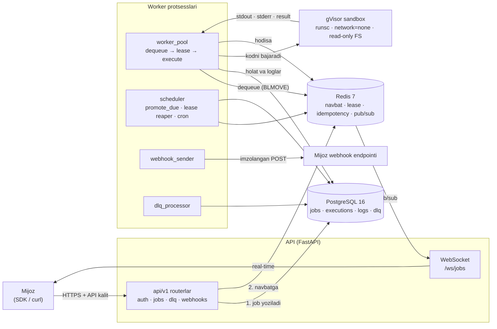

<div align="center">

# Durabl

**Ishonchli background job va kod bajarish platformasi.**
Kodingizni API orqali yuboring — Durabl uni izolyatsiyalangan sandbox ichida bajaradi,
natijani webhook yoki polling orqali qaytaradi. Job yo'qolmaydi, ikki marta bajarilmaydi.

[](https://github.com/BoburmirzoAI/durabl-core/actions/workflows/ci.yml)
[](LICENSE)


<!-- Qoplama badge'i ATAYLAB yo'q: u tashqi servis (Codecov) va token
     talab qiladi. Qoplama hisoboti har CI ishida job xulosasida
     ko'rinadi va artifact sifatida saqlanadi. -->


[Hujjatlar](#hujjatlar) · [5 daqiqada ishga tushirish](#5-daqiqada-ishga-tushirish) ·
[API](docs/API.md) · [Ishonchlilik](docs/RELIABILITY.md) · [Xavfsizlik](docs/SECURITY.md)

</div>

---

## Durabl nima?

Har bir jiddiy backend bir kun kelib fon ishini bajarishga majbur bo'ladi: rasm qayta ishlash,
hisobot generatsiya qilish, tashqi API bilan sinxronizatsiya, kechiktirilgan xat yuborish.
Odatdagi yechim — Celery yoki RQ o'rnatish, Redis ko'tarish, worker'larni Docker'ga joylash,
keyin esa oylab "job qayerda qoldi?" degan savolga javob izlash. Muammo shundaki, bu
kutubxonalar **navbat** beradi, lekin **ishonchlilik** bermaydi: worker qulasa job jimgina
yo'qoladi, tarmoq uzilsa so'rov ikki marta ketadi, muvaffaqiyatsiz job esa log faylining
qa'rida ko'rinmas bo'lib qoladi.

Durabl aynan shu bo'shliqni to'ldiradi. Siz HTTP so'rov yuborasiz — ichida bajarilishi kerak
bo'lgan kod, runtime (`python` yoki `node`), vaqt limiti va qayta urinish soni. Durabl job'ni
**avval PostgreSQL'ga yozadi**, faqat keyin Redis navbatiga qo'yadi. Shu tartib tasodifiy emas:
Redis qulasa ham job ma'lumotlar bazasida turadi va scheduler uni qayta navbatga qo'yadi.
Job hech qachon faqat xotirada yashamaydi.

Kodni bajarish — eng nozik qism. Mijoz yuborgan kod serverda ishlaydi, demak u serverga
tegmasligi kerak. Durabl har bir job uchun alohida **gVisor** (`runsc`) konteyneri yaratadi:
syscall'lar haqiqiy kernelga yetib bormaydi, tarmoq o'chirilgan, fayl tizimi faqat o'qish uchun,
CPU/RAM/PID limitlari qat'iy. Kod vaqt limitidan oshsa — konteyner o'ldiriladi, natija emas,
`timeout` sababi yoziladi.

Nihoyat, ishonchlilik. Worker job'ni olganda 15 soniyalik **lease** oladi va har 5 soniyada
**heartbeat** bilan uni yangilaydi. Worker qulasa heartbeat to'xtaydi, lease tugaydi va job
avtomatik boshqa worker'ga o'tadi. Job xato bilan tugasa eksponensial backoff bilan qayta
urinadi (1s → 2s → 4s → 8s). Barcha urinishlar tugasa — job **DLQ**'ga (o'lik xatlar navbati)
tushadi: dashboard'da ko'rinadi, sababi tasniflangan, tuzatib qayta urinish mumkin. Hech narsa
jimgina o'lmaydi.

---

## Asosiy imkoniyatlar

| Imkoniyat | Nima kafolatlanadi | Qanday amalga oshirilgan |
|---|---|---|
| **Durability** | Qabul qilingan job hech qachon yo'qolmaydi | Avval PostgreSQL (`status=pending`), keyin Redis navbati. Redis qulasa — `scheduler` DB'dan tiklaydi |
| **Idempotency** | Bir xil so'rov ikki marta bajarilmaydi | `Idempotency-Key` header + Redis'da 24 soatlik rezervatsiya + `jobs(user_id, idempotency_key)` unique constraint |
| **Isolation** | Mijoz kodi serverga va boshqa mijozlarga tegmaydi | gVisor (`runsc`) sandbox, `--network=none`, read-only rootfs, seccomp, CPU/RAM/PID limitlari |
| **Observability** | Job'ning butun hayot sikli ko'rinadi | Har holat o'zgarishi `executions` jadvaliga, stdout/stderr `execution_logs`ga, `correlation_id` bilan uchdan-uchiga kuzatuv, Prometheus metrikalari, WebSocket real-time oqim |
| **Reliability** | Worker qulasa ish davom etadi | Lease (15s) + heartbeat (5s), lease reaper, eksponensial backoff + jitter, DLQ va qo'lda qayta urinish |

Qo'shimcha: ustuvorlik navbatlari (`high`/`normal`/`low`), kechiktirilgan va cron job'lar,
imzolangan webhook'lar (replay himoyasi bilan), reja bo'yicha rate limit va kvota,
Python va JavaScript SDK, admin panel.

---

## 5 daqiqada ishga tushirish

Talablar: **Docker 24+** va **Docker Compose v2**, `make`. Lokal ishlash uchun gVisor shart emas
(`SANDBOX_ENABLED=false` bo'lsa kod subprocess'da bajariladi).

```bash
git clone https://github.com/BoburmirzoAI/durabl-core.git
cd durabl-core

python3.12 -m venv .venv      # lokal testlar va lint uchun
make install                  # bog'liqliklar + .env'ni .env.example'dan yaratadi
make dev                      # PostgreSQL + Redis + API + worker'lar + frontend
make migrate                  # alembic upgrade head — jadvallarni yaratadi
```

`make help` barcha buyruqlarni ko'rsatadi. Faqat Docker stekini ko'tarish uchun venv
shart emas — `cp .env.example .env && make dev` yetarli.

Tayyor:

| Manzil | Nima |
|---|---|
| http://localhost:8000/docs | Interaktiv API hujjati (OpenAPI) |
| http://localhost:8000/health | Sog'liq tekshiruvi (DB + Redis) |
| http://localhost:8000/metrics | Prometheus metrikalari |
| http://localhost:3000 | Dashboard (Next.js) |

`make dev` ko'taradigan servislar: `postgres`, `redis`, `api`, `worker`, `scheduler`,
`dlq-processor`, `webhook-sender`, `frontend`. Monitoring bilan ko'tarish:
`make dev-monitoring` (Prometheus `:9090`, Grafana `:3001`).

Keyingi qadamlar [`docs/DEVELOPMENT.md`](docs/DEVELOPMENT.md)da — test yurgizish,
migratsiya yaratish, bitta worker'ni alohida debug qilish.

---

## Birinchi job'ni yuborish

### 1. Ro'yxatdan o'tish va API kalit olish

```bash
# Hisob yaratish
curl -s -X POST http://localhost:8000/api/v1/auth/register \
  -H 'Content-Type: application/json' \
  -d '{"email":"men@example.com","password":"Parol12345","full_name":"Men"}'

# Kirish — access_token olamiz
TOKEN=$(curl -s -X POST http://localhost:8000/api/v1/auth/login \
  -H 'Content-Type: application/json' \
  -d '{"email":"men@example.com","password":"Parol12345"}' | jq -r .access_token)

# API kalit yaratish (xom kalit FAQAT shu javobda ko'rinadi — saqlab qo'ying)
curl -s -X POST http://localhost:8000/api/v1/api-keys \
  -H "Authorization: Bearer $TOKEN" \
  -H 'Content-Type: application/json' \
  -d '{"name":"lokal-sinov"}'
```

### 2. Job yuborish (`curl`)

```bash
curl -s -X POST http://localhost:8000/api/v1/jobs \
  -H 'X-API-Key: durabl_ABC...' \
  -H 'Content-Type: application/json' \
  -H 'Idempotency-Key: birinchi-job-001' \
  -d '{
        "code": "def main(ism):\n    print(\"salom\", ism)\n    return {\"uzunlik\": len(ism)}\n",
        "runtime": "python",
        "payload": {"args": ["Durabl"]},
        "timeout_seconds": 30,
        "max_retries": 3,
        "priority": "normal",
        "tags": ["demo"]
      }'
```

> **Kod shartnomasi:** kod `main(...)` (yoki `handler(...)`) funksiyasini e'lon qilsa va
> `payload` yuborilgan bo'lsa, Durabl uni `main(*payload["args"], **payload["kwargs"])`
> ko'rinishida chaqiradi — qaytgan qiymat job'ning `result` maydoniga tushadi.
> Funksiya bo'lmasa kod oddiy skript sifatida bajariladi, `result` `null` bo'ladi, lekin
> stdout/stderr baribir to'liq yig'iladi. To'liq shartnoma:
> [docs/SDK.md](docs/SDK.md#3-kod-shartnomasi--main-va-payload).

Javob (`201 Created`) ichida `id` keladi. Natijani olish:

```bash
JOB_ID=... # yuqoridagi javobdan

curl -s http://localhost:8000/api/v1/jobs/$JOB_ID \
  -H 'X-API-Key: durabl_ABC...'            # holat: pending → queued → running → success

curl -s http://localhost:8000/api/v1/jobs/$JOB_ID/result \
  -H 'X-API-Key: durabl_ABC...'            # tugamagan bo'lsa 409 RESULT_NOT_READY

curl -s "http://localhost:8000/api/v1/jobs/$JOB_ID/logs?limit=100" \
  -H 'X-API-Key: durabl_ABC...'            # stdout/stderr
```

### 3. Xuddi shu ish — Python SDK bilan

```python
from durabl import DurablClient

client = DurablClient(api_key="durabl_ABC...", base_url="http://localhost:8000")

job = client.submit(                     # -> JobHandle
    code="def main(ism):\n    print('salom', ism)\n    return {'uzunlik': len(ism)}\n",
    runtime="python",
    payload={"args": ["Durabl"]},        # -> main("Durabl")
    timeout=30,
    idempotency_key="birinchi-job-002",
)

natija = job.wait(timeout=60)            # -> JobResult
print(natija.stdout)       # salom Durabl
print(natija.result)       # {'uzunlik': 6}
print(natija.exit_code)    # 0
```

Dekorator usuli — funksiyani Durabl'da bajarish (manba kodi avtomatik yuboriladi):

```python
from durabl import durabl

durabl.configure(api_key="durabl_ABC...", base_url="http://localhost:8000")


@durabl.task(runtime="python", timeout=30, retries=3)
def rasm_hajmi(url: str) -> int:
    """Importlar funksiya ichida bo'lishi shart — faqat funksiya tanasi yuboriladi."""
    import urllib.request

    with urllib.request.urlopen(url) as javob:
        return len(javob.read())


job = rasm_hajmi.delay("https://example.com/img.jpg")
print(job.wait(timeout=60).value())
```

To'liq qo'llanma: [`docs/SDK.md`](docs/SDK.md).

---

## Arxitektura



Job'ning yo'li, qadam-baqadam:

1. `POST /api/v1/jobs` — `Idempotency-Key` tekshiriladi, kod validatsiyadan o'tadi, kvota nazorat qilinadi.
2. Job PostgreSQL'ga `status=pending` bilan yoziladi (**durability chegarasi** — shu nuqtadan keyin job yo'qolmaydi).
3. Job ustuvorligiga mos Redis navbatiga qo'yiladi, `status=queued`. Kechiktirilgan bo'lsa — `ZSET`ga.
4. Worker `BLMOVE` bilan navbatdan oladi, lease oladi, `executions` jadvaliga yangi urinish yozadi, `status=running`.
5. Sandbox yaratiladi, kod bajariladi, stdout/stderr oqim bo'lib yig'iladi, `result.json` o'qiladi.
6. Natija DB'ga yoziladi (`success` / `failed`), webhook navbatiga hodisa qo'yiladi, Redis pub/sub orqali WebSocket'ga uzatiladi.
7. Xato bo'lsa — retry rejalashtiriladi; urinishlar tugasa DLQ'ga tushadi.

Batafsil: [`docs/ARCHITECTURE.md`](docs/ARCHITECTURE.md), [`docs/RELIABILITY.md`](docs/RELIABILITY.md).

---

## Loyiha tuzilmasi

```
Durabl/
├── backend/                  # FastAPI — API, navbat, bajarish, ishonchlilik
│   ├── app/
│   │   ├── api/v1/           # HTTP endpointlar (biznes logika yo'q)
│   │   ├── services/         # Barcha biznes logika
│   │   ├── repositories/     # Faqat SQL
│   │   ├── models/           # SQLAlchemy jadvallar
│   │   ├── schemas/          # Pydantic so'rov/javob shakllari
│   │   ├── execution/        # Kod bajarish yadrosi (sandbox, timeout, limitlar)
│   │   ├── workers/          # worker · scheduler · dlq_processor · webhook_sender
│   │   ├── middleware/        # auth · rate limit · logging · idempotency · CORS
│   │   └── utils/            # security · validators · retry_policy · time_utils
│   ├── alembic/              # Migratsiyalar
│   └── tests/                # unit · integration · e2e
├── frontend/                 # Next.js 14 dashboard + admin panel
├── sdk/
│   ├── python/               # pip install durabl
│   └── javascript/           # npm install durabl
├── sandbox/                  # gVisor konfiguratsiya va runner image'lar
│   ├── gvisor/               # install.sh · seccomp-profile.json · daemon.json
│   ├── runners/              # python/ va node/ entrypoint + Dockerfile
│   └── policies/             # tarmoq va resurs siyosatlari
├── infra/                    # nginx · prometheus · grafana · skriptlar
├── docs/                     # Loyiha hujjatlari (shu papkadan boshlang)
├── docker-compose.yml        # Lokal development
├── docker-compose.prod.yml   # Production override (asosiy fayl ustiga qo'yiladi)
├── .env.example
└── Makefile                  # `make help` — barcha buyruqlar
```

---

## Texnologiya steki

| Qatlam | Texnologiyalar |
|---|---|
| **Backend** | Python 3.12, FastAPI, SQLAlchemy 2 (async), Alembic, Pydantic v2, PyJWT, bcrypt, httpx, structlog, prometheus-client, croniter |
| **Ma'lumot** | PostgreSQL 16 (job'lar, urinishlar, loglar, DLQ), Redis 7 (navbat, lease, idempotency, rate limit, pub/sub, cache) |
| **Sandbox** | Docker + gVisor (`runsc`), seccomp profil, read-only rootfs, minimal runner image'lar |
| **Frontend** | Next.js 14 (App Router), TypeScript, Tailwind CSS, TanStack Query v5, Zustand, Recharts, WebSocket |
| **SDK** | Python: `httpx` (3.9+); JavaScript/TypeScript: bog'liqliksiz, global `fetch` (Node 18+) |
| **Infra** | Docker Compose, Nginx (TLS), Prometheus + Grafana, Sentry (ixtiyoriy) |
| **Sifat** | pytest (+asyncio, fakeredis, aiosqlite), ruff, mypy |

---

## Hujjatlar

| Hujjat | Nima haqida |
|---|---|
| [docs/ARCHITECTURE.md](docs/ARCHITECTURE.md) | Qatlamlar, ma'lumot modeli, Redis tuzilmasi, job oqimi |
| [docs/API.md](docs/API.md) | Barcha endpointlar, autentifikatsiya, xato kodlari, webhook va WebSocket protokoli |
| [docs/RELIABILITY.md](docs/RELIABILITY.md) | Durability, idempotency, lease+heartbeat, retry, DLQ, holat mashinasi |
| [docs/SECURITY.md](docs/SECURITY.md) | Ishonch chegaralari, gVisor, 5 qatlamli himoya, sirlarni saqlash |
| [docs/DEPLOYMENT.md](docs/DEPLOYMENT.md) | Production joylashtirish, TLS, backup, masshtablash, zero-downtime yangilash |
| [docs/DEVELOPMENT.md](docs/DEVELOPMENT.md) | Lokal muhit, testlar, migratsiya, kod uslubi, yangi endpoint qo'shish |
| [docs/SDK.md](docs/SDK.md) | Python va JavaScript SDK to'liq qo'llanmasi |
| [docs/OPERATIONS.md](docs/OPERATIONS.md) | Monitoring, SLO, alertlar, runbook'lar |
| [docs/CONTRACTS.md](docs/CONTRACTS.md) | Ishlab chiqish shartnomasi — kod yozishdan oldin o'qiladi |

Komponent READMEʼlari: [backend](backend/README.md) · [frontend](frontend/README.md) · [sdk](sdk/README.md) · [sandbox](sandbox/README.md)

---

## Hissa qo'shish

1. Issue oching — nima o'zgarishini va nega kerakligini yozing.
2. `docs/CONTRACTS.md` ni o'qing: nomlar, imzolar va qatlam qoidalari shu yerda kelishilgan.
3. Branch oching, kod yozing, test qo'shing.
4. Yuborishdan oldin: `make check` (lint + typecheck + test) — uchtasi ham toza bo'lishi kerak.
5. Pull request oching, o'zgarish sababini tushuntiring.

Qoidalar qisqa: izohlar va docstring'lar **o'zbek tilida**, kod identifikatorlari ingliz tilida;
`TODO`/`pass` qoldirilmaydi; `print()` emas, `structlog`; `os.environ` emas, `settings`;
"magic string" emas, `app.constants` enumlari.

## Litsenziya

MIT — `LICENSE` fayliga qarang.

---

## Tez boshlash (Docker)

Noldan to'liq ishlaydigan tizimgacha **bitta buyruq**:

```bash
make setup
```

Bu quyidagilarni ketma-ket bajaradi:

1. `.env` yaratadi (`.env.example` dan) va portlarni tekshiradi
2. Sandbox runner image'larini yig'adi (`durabl/runner-python`, `durabl/runner-node`)
3. Servis image'larini yig'adi
4. Butun stekni ko'taradi — **migratsiya avtomatik bajariladi** (`migrate` servisi
   `postgres` sog'ayishini kutadi, qolgan servislar esa uning tugashini)
5. Demo ma'lumot yuklaydi (2 foydalanuvchi, 30 job, DLQ, webhook, API kalit)
6. Admin hisobi yaratadi

Tugagach:

| | |
|---|---|
| API | http://localhost:8000 |
| API hujjatlari | http://localhost:8000/docs |
| Frontend | http://localhost:3000 |

Interaktivsiz (CI yoki skript uchun):

```bash
EMAIL=admin@durabl.dev PASSWORD='Parol12345' make setup
```

### Agar port band bo'lsa

`make setup` portlarni **oldindan tekshiradi** va qaysi jarayon band qilganini
aytadi. `.env` da o'zgartiring:

```bash
FRONTEND_PORT=3001
POSTGRES_PORT=5433
```

### Kundalik buyruqlar

```bash
make up            # ko'tarish
make down          # to'xtatish (ma'lumot saqlanadi)
make status        # hammasining holati bir qarashda
make logs-worker   # bitta servis logi
make db-shell      # psql
make list-users    # foydalanuvchilar
make sandbox-test  # sandbox ishlayaptimi
make help          # barcha buyruqlar
```

Barcha buyruqlar: `make help`.

---

## gVisor (runsc) — Linux serverda yoqish

Dasturchi mashinasida (macOS) sandbox **`runc`** bilan ishlaydi: tarmoq
yopiq, fayl tizimi read-only, non-root, seccomp profili qo'llaniladi.
Bu haqiqiy izolyatsiya, lekin **gVisor emas**.

gVisor Linux yadrosiga bog'liq, shuning uchun u faqat Linux hostda ishlaydi:

```bash
# 1. runsc'ni o'rnatish va Docker'ga ro'yxatdan o'tkazish
make gvisor-install

# 2. Tekshirish — ro'yxatda `runsc` ko'rinishi kerak
docker info | grep -A3 Runtimes

# 3. .env da runtime'ni almashtirish
SANDBOX_RUNTIME=runsc

# 4. Worker'larni qayta ishga tushirish
make restart s=worker

# 5. Tasdiqlash
make sandbox-test     # chiqishda "Runtime runsc" yozilishi kerak
```

macOS'da `make gvisor-install` xato bermaydi — u ogohlantirish chiqaradi va
`runc` bilan davom etishni aytadi.

**Ishlab chiqarishda `SANDBOX_RUNTIME=runsc` bo'lishi SHART.** `docker-compose.prod.yml`
da standart qiymat aynan shunday.
